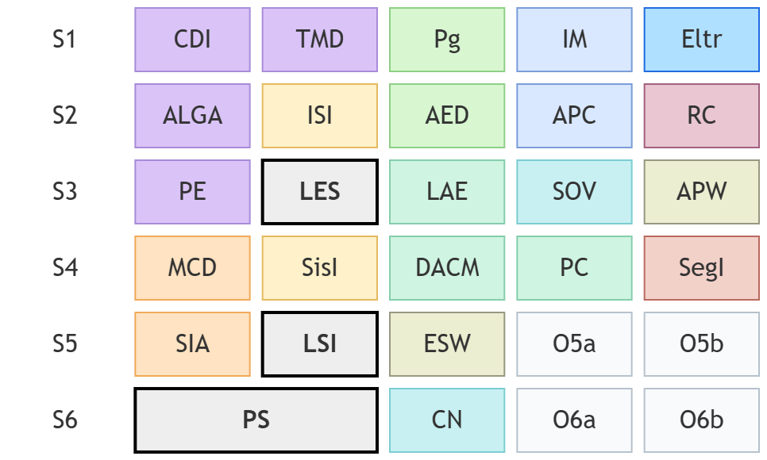

## ISEL - Licenciatura em Engenharia Informática e de Computadores

**NOTA:** Este é um exercício pessoal sobre o plano de estudos da LEIC. **Não** constitui informação oficial nem documento de trabalho institucional.
 

---

### Distribuição de Créditos por Áreas Científicas

| Área Científica | Sigla | ECTS Obrigatórios | ECTS Optativos |
| --------------- | :---: | :---------------: | :------------: |
| Matemática      |  MAT  |         24        |      0–12      |
| Engenharia Informática e de Computadores | IC | 123 |  6–18  |
| Engenharia Eletrónica e Telecomunicações | ET |  6  |  0–12  |
| Competências Transversais | CT |   3        |      6–12      |
| **Total**       |   —   |      **156**      |     **24**     |

*As quatro opções têm 6 ECTS cada. O percurso inclui pelo menos uma opção em IC e uma em CT. Os intervalos das áreas científicas não são independentes. Em Projeto e Seminário, 9 ECTS pertencem a IC e 3 ECTS a CT.*

---

## Plano de Estudos

### 1.º Ano

#### 1.º Semestre

| Unidade Curricular | Área | Horas Totais | ECTS |
| ------------------ | :--: | :----------: | :--: |
| Cálculo Diferencial e Integral | MAT | 162 | 6 |
| Eletrónica | ET | 162 | 6 |
| Introdução aos Microprocessadores | IC | 162 | 6 |
| Programação | IC | 162 | 6 |
| Tópicos de Matemática Discreta | MAT | 162 | 6 |

#### 2.º Semestre

| Unidade Curricular | Área | Horas Totais | ECTS |
| ------------------ | :--: | :----------: | :--: |
| Álgebra Linear e Geometria Analítica | MAT | 162 | 6 |
| Algoritmos e Estruturas de Dados | IC | 162 | 6 |
| Arquitetura e Programação de Computadores | IC | 162 | 6 |
| Introdução aos Sistemas de Informação | IC | 162 | 6 |
| Redes de Computadores | IC | 162 | 6 |

---

### 2.º Ano

#### 3.º Semestre

| Unidade Curricular | Área | Horas Totais | ECTS |
| ------------------ | :--: | :----------: | :--: |
| Arquitetura e Programação Web | IC | 162 | 6 |
| Laboratório de Engenharia de Software | IC | 162 | 6 |
| Linguagens e Ambientes de Execução | IC | 162 | 6 |
| Probabilidade e Estatística | MAT | 162 | 6 |
| Sistemas Operativos e Virtualização | IC | 162 | 6 |

#### 4.º Semestre

| Unidade Curricular | Área | Horas Totais | ECTS |
| ------------------ | :--: | :----------: | :--: |
| Desenvolvimento de Aplicações Cliente e Móveis | IC | 162 | 6 |
| Métodos de Ciência de Dados | IC | 162 | 6 |
| Programação Concorrente | IC | 162 | 6 |
| Segurança Informática | IC | 162 | 6 |
| Sistemas de Informação | IC | 162 | 6 |

---

### 3.º Ano

#### 5.º Semestre

| Unidade Curricular | Área | Horas Totais | ECTS |
| ------------------ | :--: | :----------: | :--: |
| Engenharia de Sistemas Web | IC | 162 | 6 |
| Laboratório de Sistemas Informáticos | IC | 162 | 6 |
| Sistemas Inteligentes e Agentes | IC | 162 | 6 |
| Opção 5A | MAT/IC/ET/CT | 162 | 6 |
| Opção 5B | MAT/IC/ET/CT | 162 | 6 |

#### 6.º Semestre

| Unidade Curricular | Área | Horas Totais | ECTS |
| ------------------ | :--: | :----------: | :--: |
| Projeto e Seminário | IC+CT | 324 | 12 |
| Computação na Nuvem | IC | 162 | 6 |
| Opção 6A | MAT/IC/ET/CT | 162 | 6 |
| Opção 6B | MAT/IC/ET/CT | 162 | 6 |

---

### Unidades Curriculares Optativas

As opções 5A, 5B, 6A e 6B são selecionadas do elenco seguinte, sujeito à organização anual da oferta e às condições de distribuição de créditos por área científica indicadas acima.

#### Opções 5A/5B e 6A/6B (exceto CT)

| Unidade Curricular | Área | Horas Totais | ECTS |
| ------------------ | :--: | :----------: | :--: |
| Comunicação Digital | IC | 162 | 6 |
| Engenharia de Dados em Larga Escala | IC | 162 | 6 |
| Inteligência Artificial para Sistemas Autónomos | IC | 162 | 6 |
| Introdução à Compressão de Dados | IC | 162 | 6 |
| Laboratório de Informática e Computadores | IC | 162 | 6 |
| Lógica e Computação | IC | 162 | 6 |
| Redes de Internet | IC | 162 | 6 |
| Sistemas Embebidos | IC | 162 | 6 |
| Sistemas Embebidos para a Internet das Coisas | IC | 162 | 6 |
| Tecnologias Avançadas de Redes | IC | 162 | 6 |
| Tópicos de Inteligência Artificial Simbólica | IC | 162 | 6 |
| Codificação de Sinais Multimédia | ET | 162 | 6 |
| Álgebra e Aplicações | MAT | 162 | 6 |
| Análise Complexa | MAT | 162 | 6 |
| Complementos de Investigação Operacional | MAT | 162 | 6 |
| Controlo de Qualidade e Fiabilidade | MAT | 162 | 6 |
| Geometria e Aplicações | MAT | 162 | 6 |
| Introdução à Estatística Bayesiana | MAT | 162 | 6 |
| Investigação Operacional | MAT | 162 | 6 |
| Técnicas de Estatística Multivariada | MAT | 162 | 6 |

#### Opções 5A/5B e 6A/6B (CT)

| Unidade Curricular | Área | Horas Totais | ECTS |
| ------------------ | :--: | :----------: | :--: |
| Competências de Engenharia de Sistemas | CT | 162 | 6 |
| Comunicação e Inovação em Engenharia | CT | 162 | 6 |
| Comunicação e Sociedade | CT | 162 | 6 |
| Economia e Gestão de Projeto | CT | 162 | 6 |
| Empreendedorismo | CT | 162 | 6 |
| Gestão da Qualidade em Saúde | CT | 162 | 6 |
| Gestão de Equipamentos Médicos | CT | 162 | 6 |
| Gestão e Avaliação de Projetos | CT | 162 | 6 |
| Marketing e Comunicação Interpessoal | CT | 162 | 6 |
| Sistemas de Gestão | CT | 162 | 6 |
